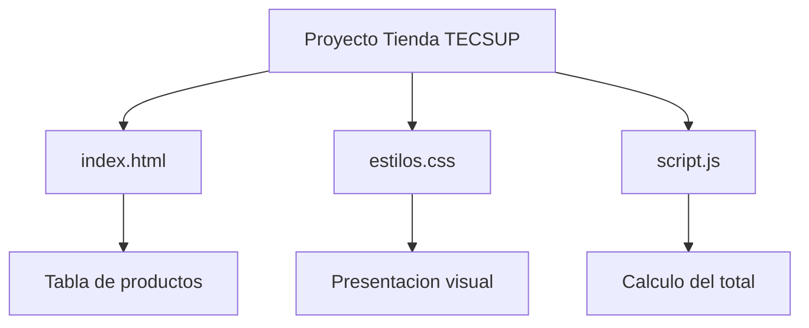

# Tienda TECSUP


## Descripcion

Tienda TECSUP es un proyecto web sencillo que muestra productos, precios y cantidades, y calcula el importe total de una compra.
Esta dirigido a estudiantes que desean practicar HTML, CSS, JavaScript y el trabajo colaborativo mediante Git y GitHub.

## Tabla de contenidos

- [Instalacion](#instalacion)
- [Uso](#uso)
- [Tecnologias](#tecnologias)
- [Estado de las funciones](#estado-de-las-funciones)
- [Hoja de ruta](#hoja-de-ruta)
- [Ejemplos de codigo](#ejemplos-de-codigo)
- [Arquitectura](#arquitectura)
- [Contribucion](#contribucion)
- [Autor](#autor)

## Instalacion

Clona el repositorio desde GitHub:

```bash
git clone https://github.com/miguelalvareztt-pixel/tienda-tecsup.git
cd tienda-tecsup
```

No es necesario instalar dependencias adicionales.

## Uso

1. Abre el archivo `index.html` en el navegador.
2. Observa la tabla de productos con sus precios y cantidades.
3. Comprueba el importe total calculado por JavaScript.
4. Si los estilos no se muestran, revisa la ruta del archivo CSS.

## Tecnologias

- **HTML5:** estructura de la pagina.
- **CSS3:** presentacion visual.
- **JavaScript:** calculo del importe total.
- **Git:** control de versiones.
- **GitHub:** publicacion y colaboracion.

## Estado de las funciones

| Funcion | Estado | Prioridad |
|:--------|:------:|----------:|
| Mostrar productos | Implementado | Alta |
| Calcular el total | Implementado | Alta |
| Presentacion visual CSS | En revision | Media |
| Mejorar la documentacion | En desarrollo | Media |

## Hoja de ruta

- [x] Crear la estructura HTML.
- [x] Mostrar los productos y cantidades.
- [x] Implementar el calculo del total.
- [x] Crear el repositorio en GitHub.
- [ ] Revisar la ruta del archivo CSS.
- [ ] Agregar pruebas adicionales.
- [ ] Mejorar la experiencia del usuario.

## Ejemplos de codigo

### HTML

Ejemplo de la tabla de productos:

```html
<table>
  <tr>
    <th>Producto</th>
    <th>Precio</th>
    <th>Cantidad</th>
  </tr>
  <tr>
    <td>Polo TECSUP</td>
    <td>S/ 25.00</td>
    <td>2</td>
  </tr>
  <tr>
    <td>Taza TECSUP</td>
    <td>S/ 18.00</td>
    <td>1</td>
  </tr>
</table>
```

### JavaScript

Ejemplo del calculo del total:

```js
const total = (25 * 2) + (18 * 1);
document.getElementById("total").textContent =
  "Total: S/ " + total.toFixed(2);
```

Resultado esperado: **S/ 68.00**.

## Arquitectura

El proyecto utiliza tres archivos principales para separar estructura, estilos y comportamiento.



## Contribucion

Este proyecto permite proponer mejoras y reportar errores mediante GitHub Issues y Pull Requests.

Lee la [guia de contribucion](CONTRIBUTING.md) antes de enviar cambios.

## Autor

Desarrollado por **Miguel Angel Alvarez Ttito**.

[Mi perfil de GitHub](https://github.com/miguelalvareztt-pixel)
